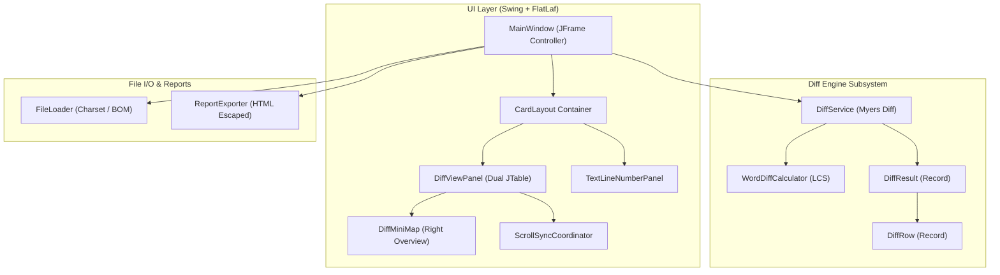

# Project Memory & Knowledge Bank

> **Project:** Offline Java Compare Tool (`java-diff-compare`)  
> **Target Platform:** Java 21 LTS  
> **Build System:** Apache Maven (`pom.xml`)  
> **Primary Package:** `com.javacompare`  
> **Storage Location:** [`doc/memory.md`](file:///e:/java_compare_classes_project/doc/memory.md)  
> **Last Updated:** 2026-10-28  

---

## 1. Executive Summary & Purpose

The **Offline Java Compare Tool** is a high-performance, distraction-free desktop application for parallel side-by-side file and text comparison. It is engineered with **Java 21 LTS**, **Java Swing**, and **FlatLaf 3.5.4**, featuring a high-contrast **Neo-Brutalist** design system with bold 2px solid black borders, hard offset drop shadows (zero blur), saturated color blocking (Electric Yellow, Lime Green, Pink-Red, Cyan), and physical tactile buttons.

### Core Pillars
1. **100% Offline & Private:** Zero network calls, zero telemetry, zero external dependencies at runtime. Runs entirely inside local JVM memory.
2. **Git-Style Parallel Split Diff:** Side-by-side dual-pane presentation. Unchanged matching lines remain clean ("if match leave it"), while insertions (green), deletions (red), and modifications (red/green with intra-line badges) are highlighted with lock-step virtual spacers.
3. **Synchronized Dual Navigation:** Lock-step scrolling, overview mini-map with click-to-jump, and step-by-step diff navigation (`◀ PREVIOUS` / `NEXT ▶`).
4. **Resilient File Ingestion:** Drag-and-drop from Windows Explorer, direct text pasting, automated charset detection (UTF-8, UTF-16, ISO-8859-1), and BOM stripping.

---

## 2. Technology Stack & Dependencies

All dependencies are defined in [`pom.xml`](file:///e:/java_compare_classes_project/pom.xml):

| Component / Layer | Technology | Version | Purpose |
| :--- | :--- | :--- | :--- |
| **Runtime Language** | Java LTS | `21` | Modern language features: Records, Pattern Matching, Text Blocks, Virtual Threads |
| **Look and Feel** | FlatLaf | `3.5.4` | High-DPI, pure Light/Dark look-and-feel with crisp typography |
| **Diff Engine** | `java-diff-utils` | `4.12` | Core Myers diff algorithm delta computation |
| **Logging Facade** | SLF4J API | `2.0.12` | Structured logging abstraction |
| **Logging Backend** | Logback Classic | `1.5.3` | Console appender and formatting via `logback.xml` |
| **Testing Framework** | JUnit Jupiter | `5.10.2` | Automated unit and regression test suite |
| **Assertions** | AssertJ Core | `3.25.3` | Fluent assertion library for unit testing |
| **Packaging** | Maven Shade Plugin | `3.5.2` | Standalone executable Fat-JAR generation |

---

## 3. High-Level Architecture & Component Map

The project separates presentation, algorithmic computation, and I/O infrastructure into clear modules:



---

## 4. Package Structure & Key Classes

```
src/main/java/com/javacompare/
├── App.java                              # Main entry point; initializes High-DPI & Neo-Brutalist Look and Feel
├── diff/
│   ├── DiffService.java                  # Myers diff execution, row alignment, unchanged folding
│   └── WordDiffCalculator.java           # Tokenization & LCS intra-line character/word badges
├── model/
│   ├── DiffOptions.java                  # Immutable comparison options (ignoreCase, trim, wrap, etc.)
│   ├── DiffResult.java                   # Aggregate diff result record (counts, indices, rows)
│   ├── DiffRow.java                      # Aligned display row record with left/right spans
│   ├── DiffType.java                     # Diff classification enum (EQUAL, INSERT, DELETE, CHANGE, SPACER)
│   └── TextSpan.java                     # Sub-string span record for word/token highlighting
├── ui/
│   ├── DiffMiniMap.java                  # Right-side overview bar with hard shadow and slider thumb
│   ├── DiffViewPanel.java                # Dual JTable visual diff viewer with Git-style gutters & Neo-Brutalist cards
│   ├── MainWindow.java                   # Primary frame, Neo-Brutalist header/toolbar dock, CardLayout switch
│   ├── ScrollSyncCoordinator.java        # Bidirectional scroll synchronization with recursion locks
│   ├── TextLineNumberPanel.java          # Smart JTextArea row gutter with 2px solid divider border
│   └── neobrutalism/
│       ├── NeoBrutalistBadge.java        # Status & count badge with 2px border and hard drop shadow
│       ├── NeoBrutalistButton.java       # Tactile button (mechanical shift on click, zero-blur shadow)
│       ├── NeoBrutalistPanel.java        # Container card with 2px border and 4px offset shadow
│       ├── NeoBrutalistScrollBarUI.java  # High-contrast scrollbar with solid borders and colored thumb
│       ├── NeoBrutalistTheme.java        # Global palette manager (Retro Light & Cyber Dark) and listeners
│       ├── NeoBrutalistToggle.java       # Chunky switch toggle with sliding thumb and Electric Yellow fill
│       └── NeoBrutalistUtils.java        # Java 2D hard shadow, border outline, and card renderers
└── util/
    ├── FileLoader.java                   # File reader with UTF-8 / UTF-16 BOM detection & stripping
    └── ReportExporter.java               # Standalone Neo-Brutalist HTML report generator with XSS sanitization
```

---

## 5. Domain Models & Core Data Contracts

All models are defined as Java 21 **records** to ensure thread safety and immutability:

- **[`DiffOptions`](file:///e:/java_compare_classes_project/src/main/java/com/javacompare/model/DiffOptions.java):**
  - `ignoreCase`: Case-insensitive comparison.
  - `trimWhitespace`: Leading/trailing whitespace normalization (default: `true`).
  - `ignoreBlankLines`: Skip blank line differences.
  - `hideUnchanged`: Fold identical lines into context blocks (default: `false`).
  - `wordWrap`: Soft wrapping in editor panes (default: `true`).
- **[`DiffRow`](file:///e:/java_compare_classes_project/src/main/java/com/javacompare/model/DiffRow.java):**
  - `leftLineNum`, `leftText`, `rightLineNum`, `rightText`.
  - `type`: [`DiffType`](file:///e:/java_compare_classes_project/src/main/java/com/javacompare/model/DiffType.java) (`EQUAL`, `INSERT`, `DELETE`, `CHANGE`, `SPACER`).
  - `leftSpans`, `rightSpans`: `List<TextSpan>` for intra-line word difference badges.
  - `isDifference()` helper returning `true` for `INSERT`, `DELETE`, or `CHANGE`.
- **[`DiffResult`](file:///e:/java_compare_classes_project/src/main/java/com/javacompare/model/DiffResult.java):**
  - Contains full list of `DiffRow` items, diff chunk counts, insertion/deletion/modification totals, and list of difference row indices (`diffRowIndices`) for navigation.
- **[`TextSpan`](file:///e:/java_compare_classes_project/src/main/java/com/javacompare/model/TextSpan.java):**
  - Zero-based start index and length representing changed tokens inside modified lines.

---

## 6. Algorithmic Mechanics & Workflows

### 6.1. Myers Diff & Spacer Alignment ([`DiffService`](file:///e:/java_compare_classes_project/src/main/java/com/javacompare/diff/DiffService.java))
1. **Normalization:** Input lines are pre-processed based on [`DiffOptions`](file:///e:/java_compare_classes_project/src/main/java/com/javacompare/model/DiffOptions.java) (`trimWhitespace`, `ignoreCase`).
2. **Delta Calculation:** Uses `DiffUtils.diff(normalizedOriginal, normalizedModified)` producing `ChangeDelta`, `DeleteDelta`, and `InsertDelta`.
3. **Alignment & Gap Insertion:**
   - Lines prior to deltas are added as `DiffType.EQUAL`.
   - `DeleteDelta`: Line appears on left side (`1-`), while right side receives an empty row (`rightLineNum = -1`) representing an aligned **GAP**.
   - `InsertDelta`: Line appears on right side (`1+`), while left side receives an empty row (`leftLineNum = -1`).
   - `ChangeDelta`: Both sides are populated. If left and right delta chunk line counts differ, trailing virtual spacers balance the block.
4. **Intra-line Word LCS:** For `ChangeDelta` rows, [`WordDiffCalculator`](file:///e:/java_compare_classes_project/src/main/java/com/javacompare/diff/WordDiffCalculator.java) executes a tokenized LCS algorithm on words/punctuation, generating character highlight spans.
5. **Hide Unchanged Folding:** If `hideUnchanged` is selected, unchanged runs are collapsed, preserving 2 lines of surrounding context and inserting a `DiffType.SPACER` label (`··· (X unchanged lines hidden) ···`).

### 6.2. Dual-Mode UI Navigation ([`MainWindow`](file:///e:/java_compare_classes_project/src/main/java/com/javacompare/ui/MainWindow.java))
- **CardLayout Views:**
  - `EDITOR`: Dual editable `JTextArea` panes equipped with dynamic [`TextLineNumberPanel`](file:///e:/java_compare_classes_project/src/main/java/com/javacompare/ui/TextLineNumberPanel.java) gutters.
  - `DIFF`: Git-style side-by-side read-only [`DiffViewPanel`](file:///e:/java_compare_classes_project/src/main/java/com/javacompare/ui/DiffViewPanel.java).
- **Mode Switching:** Click `🔍 Visual Diff View` / `✏️ Edit Text Mode` or click `⚡ COMPARE`.
- **Step-by-Step Navigation:** `◀ PREVIOUS` and `NEXT ▶` jump to row indices from `diffRowIndices`, scrolling both tables and selecting the diff row.

### 6.3. Table Rendering & Git Styling ([`DiffViewPanel`](file:///e:/java_compare_classes_project/src/main/java/com/javacompare/ui/DiffViewPanel.java))
- **Hidden Metadata Column:** Table uses a 3-column model (`#`, `Content`, `Meta`). Column 2 (`Meta`) holds the underlying [`DiffRow`](file:///e:/java_compare_classes_project/src/main/java/com/javacompare/model/DiffRow.java) object and is removed from the view column model while remaining accessible by the renderers.
- **Dynamic Gutter Width:** Calculated using `Math.max(62, digits * charW + 32)` to accommodate large line numbers without truncation.
- **Diagonal Gap Hatching:** When an opposing side has an insertion or deletion (`lineNum <= 0`), `paintHatchPattern()` draws subtle diagonal stripes across the cell and gutter.
- **Intra-line Word Badges:** Drawn as rounded rectangles (`fillRoundRect`) using calculated character pixel widths directly over changed tokens.

### 6.4. Scroll Synchronization ([`ScrollSyncCoordinator`](file:///e:/java_compare_classes_project/src/main/java/com/javacompare/ui/ScrollSyncCoordinator.java))
- Attaches to vertical and horizontal `JScrollBar` instances on both panes.
- Uses an internal boolean `isUpdating` recursion flag to prevent infinite ping-pong event loops between scroll listeners.

### 6.5. Overview Mini-Map ([`DiffMiniMap`](file:///e:/java_compare_classes_project/src/main/java/com/javacompare/ui/DiffMiniMap.java))
- Positioned on the right edge (`16px` wide).
- Renders colored tick markers (`Insert` = Green, `Delete` = Red, `Change` = Blue) proportional to document height.
- Displays a translucent draggable/clickable viewport indicator that triggers `ScrollSyncCoordinator.scrollToFraction()`.

### 6.6. File Ingestion & Export ([`FileLoader`](file:///e:/java_compare_classes_project/src/main/java/com/javacompare/util/FileLoader.java) & [`ReportExporter`](file:///e:/java_compare_classes_project/src/main/java/com/javacompare/util/ReportExporter.java))
- **Charset & BOM Detection:** Detects UTF-8 (`EF BB BF`), UTF-16BE (`FE FF`), UTF-16LE (`FF FE`), and strips BOM headers before decoding into Java Strings.
- **HTML Export Sanitization:** Escapes all special characters (`&`, `<`, `>`, `"`, `'`) to prevent XSS vulnerabilities in exported reports.

---

## 7. Design System & Theming Tokens

Defined in [`doc/design_system.md`](file:///e:/java_compare_classes_project/doc/design_system.md):

| Semantic Token | Light Neo-Brutalism | Cyber Dark Neo-Brutalism | Application |
| :--- | :--- | :--- | :--- |
| **Canvas Background** | `#fdfaf3` (Warm Retro Cream) | `#141416` (Deep Obsidian) | Main window backdrop |
| **Surface Card** | `#ffffff` (Stark White) | `#1e1e22` (Card Dark) | Editor panes & container cards |
| **Surface Alt / Gutter** | `#f5f1e9` | `#282830` | Header strips & line gutters |
| **Solid Border Outline** | `#000000` (Solid 2px Black) | `#ffffff` / `#000000` | Bold border strokes |
| **Hard Offset Drop Shadow** | `#000000` (Zero Blur) | `#000000` | Hard offset drop shadow (3-4px) |
| **Electric Yellow Accent** | `#ffe600` | `#ffe600` | Theme toggle & selection highlight |
| **Vibrant Lime Accent** | `#00f076` | `#00f076` | Compare button (`⚡`) & additions |
| **Electric Pink-Red Accent** | `#ff4365` | `#ff4365` | Reset button (`🔄`) & deletions |
| **Electric Blue Accent** | `#38b6ff` | `#38b6ff` | Visual diff toggle & informational |
| **Insertion Background** | `#e6fce8` | `#0c2c16` | Full row background for added lines |
| **Insertion Word Badge** | `#00f076` + 1px outline | `#00b455` | Intra-line added token badge |
| **Deletion Background** | `#ffebee` | `#370e16` | Full row background for deleted lines |
| **Deletion Word Badge** | `#ff4365` + 1px outline | `#be1e3c` | Intra-line deleted token badge |
| **Gap / Spacer Pattern** | `#f2f2f2` + `#bebebe` stripes | `#18181c` + `#323238` stripes | Opposing virtual alignment spacers |

---

## 8. Build, Test & Run Lifecycle

### Standard Maven Commands
```bash
# Compile and run directly via exec plugin
mvn clean compile exec:java

# Run test suites (JUnit 5 + AssertJ)
mvn test

# Package standalone executable Fat-JAR
mvn clean package

# Run the packaged JAR
java -jar target/java-diff-compare-1.0.0.jar
```

### High-DPI VM Flags Configured in [`App.java`](file:///e:/java_compare_classes_project/src/main/java/com/javacompare/App.java)
- `sun.java2d.uiScale.enabled=true`
- `awt.useSystemAAFontSettings=on`
- `swing.aatext=true`

---

## 9. Critical Development Rules & Anti-Patterns

1. **EDT Safety:** Any code touching Swing components must run on the Event Dispatch Thread via `SwingUtilities.invokeLater()`.
2. **Decoupled Myers Diff:** Never mix Swing or AWT classes into `com.javacompare.diff` or `com.javacompare.model`.
3. **Structured Logging:** Always use `private static final Logger log = LoggerFactory.getLogger(YourClass.class)`. Never use `System.out.println()` or `e.printStackTrace()`.
4. **Infinite Scroll Recursion Guard:** Always guard scrollbar updates in [`ScrollSyncCoordinator`](file:///e:/java_compare_classes_project/src/main/java/com/javacompare/ui/ScrollSyncCoordinator.java) with an `isUpdating` flag.
5. **No Intermediate Muddy Grays:** In theme styling, adhere to crisp high-contrast pure White (`#ffffff`) and pure Black (`#000000` / `#0d1117`).
6. **XSS Prevention:** Ensure all exported report text passes through HTML escaping in [`ReportExporter`](file:///e:/java_compare_classes_project/src/main/java/com/javacompare/util/ReportExporter.java).

---

## 10. Complete Documentation Index

| Documentation File | Location | Focus Area |
| :--- | :--- | :--- |
| **`memory.md`** | [`doc/memory.md`](file:///e:/java_compare_classes_project/doc/memory.md) | Living project memory, technical handbook, and architecture reference. |
| **`prd.md`** | [`doc/prd.md`](file:///e:/java_compare_classes_project/doc/prd.md) | Product Requirements Document, feature breakdown, user personas. |
| **`Architecture.md`** | [`doc/Architecture.md`](file:///e:/java_compare_classes_project/doc/Architecture.md) | System architecture, sequence diagrams, and module interactions. |
| **`Readme.md`** | [`doc/Readme.md`](file:///e:/java_compare_classes_project/doc/Readme.md) | Getting started, Maven build commands, and layout diagrams. |
| **`design_system.md`** | [`doc/design_system.md`](file:///e:/java_compare_classes_project/doc/design_system.md) | Color palettes, typography, UI dimensions, and theme tokens. |
| **`code_style.md`** | [`doc/code_style.md`](file:///e:/java_compare_classes_project/doc/code_style.md) | Java 21 coding standards, SLF4J rules, and Clean Code guidelines. |
| **`implementation_plan.md`**| [`doc/implementation_plan.md`](file:///e:/java_compare_classes_project/doc/implementation_plan.md)| Development phase roadmap and milestone verification. |
| **`testing.md`** | [`doc/testing.md`](file:///e:/java_compare_classes_project/doc/testing.md) | Test cases, scenarios, and QA strategy. |
| **`security.md`** | [`doc/security.md`](file:///e:/java_compare_classes_project/doc/security.md) | Offline privacy, zero telemetry, read-only file access. |
| **`Agents.md`** | [`doc/Agents.md`](file:///e:/java_compare_classes_project/doc/Agents.md) | AI coding agent instructions and architectural guardrails. |
| **`documentation-audit.md`**| [`doc/documentation-audit.md`](file:///e:/java_compare_classes_project/doc/documentation-audit.md)| Documentation inventory and audit tracking matrix. |
